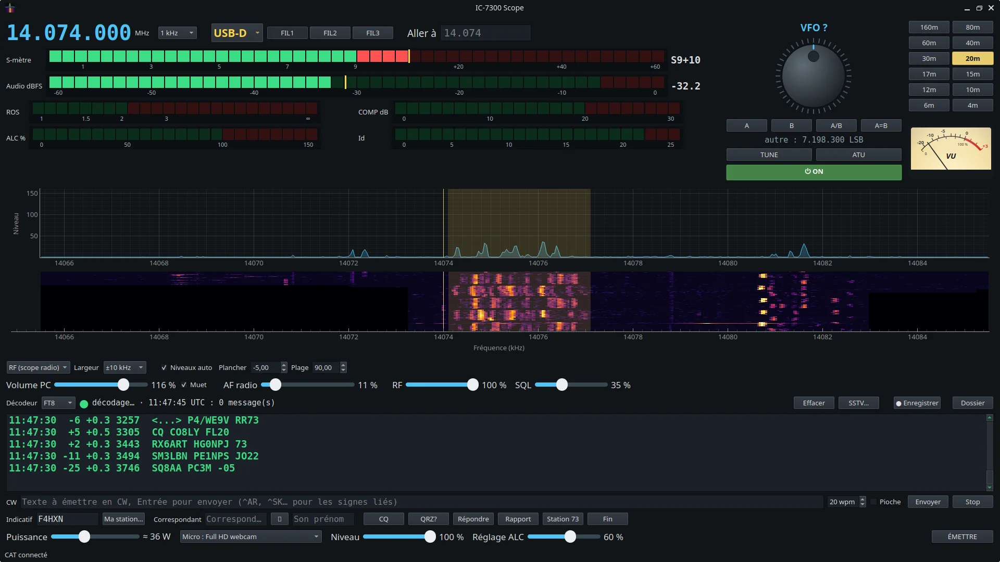

<div align="center">

# 📻 IC-7300 Scope

**Le poste de trafic complet pour l'Icom IC-7300, sous Linux.**

Spectre, waterfall, décodeurs numériques, émission CW, RTTY, FT8 et FT4, carnet de trafic
et pilotage à distance,
dans une seule fenêtre.


</div>

---

## Sommaire

- [Aperçu](#aperçu)
- [Fonctions](#fonctions)
- [Installation](#installation)
- [Utilisation](#utilisation)
- [Trafic en CW](#trafic-en-cw)
- [Piloter la radio depuis un autre PC](#piloter-la-radio-depuis-un-autre-pc)
- [Organisation du code](#organisation-du-code)
- [Manuel complet](MANUEL.md)
- [Historique des modifications](CHANGELOG.md)

---

## Aperçu



IC-7300 Scope se branche sur l'IC-7300 par **un seul câble USB**, qui porte à
la fois la commande **CI-V** et la **carte son** intégrée à la radio. Il n'y a
ni interface externe ni logiciel de pilotage à installer.

```
 IC-7300 ──USB──┬── CI-V (CP2102) ───── fréquence, mode, S-mètre, scope RF, PTT, CW
                └── USB Audio CODEC ─── son reçu → spectre, waterfall, décodeurs
                                        son émis ← FT8, FT4, SSTV, RTTY, micro, fichier
```

---

## Fonctions

### 🔭 Affichage

| | |
|---|---|
| **Scope RF** | Le spectre de la radio elle-même, lu en CI-V : clic pour aller à la fréquence exacte de la souris, glisser comme un VFO, molette au pas choisi |
| **Spectre audio** | FFT du son reçu, jusqu'à 3,5 kHz par défaut (`--fmax`) |
| **Waterfall** | Hauteur réglable **à la souris** en tirant la séparation avec le spectre |
| **S-mètre** | En bargraph, lu en continu |
| **Mesures TX** | Puissance, **ROS** et **ALC** pendant l'émission |

### 🎛️ Commandes de la radio

| | |
|---|---|
| **Bandes** | De 160 m à 4 m, fréquence et mode de départ pour chacune |
| **Mémoires** | Celles du PC et les 99 canaux de la radio : lecture au démarrage, envoi, modification, effacement |
| **Presets** | Mode, filtre, largeur, puissance, USB MOD Level et décodeur d'un clic (FT8, FT4, RTTY, CW au départ, et les siens) |
| **Réglages** | Volume, AF, **RF GAIN**, **SQL**, puissance, niveau TX |
| **Boutons** | `TUNE`, `ATU`, filtres `FIL1-3` et leur largeur, VFO A/B, marche/arrêt `⏻` |
| **Sécurité** | L'écoute sur le PC se coupe pendant toute émission (pas de larsen) |

### 🔤 Décodeurs

| Mode | Principe |
|---|---|
| **CW** | Démodulation à la note, seuil adaptatif, vitesse suivie automatiquement |
| **RTTY 45** | 45,45 bauds, écart 170 Hz, Baudot ITA2 |
| **RTTY 50 météo** | 50 bauds, écart 450 Hz : bulletins de la météo allemande (DWD) |
| **FT8 / FT4** | Créneaux calés sur l'heure UTC, décodage par `jt9` (moteur de WSJT-X), anticipé avant la fin du créneau pour répondre au suivant |
| **SSTV** | Réception et émission : Martin, Scottie, Robot, PD ; 4 lignes de texte en couleur sur l'image |
| **Fax météo** | Cartes WEFAX 120 lignes/min, IOC 576 (DWD Pinneberg…), calage et pente automatiques |

### 📡 Émission

- **CW** tapée au clavier, envoyée par le manipulateur interne de la radio (CI-V),
  avec vitesse réglable et arrêt immédiat ; en **direct** (chaque lettre part
  aussitôt) ou **à la pioche** (rythme humain, ligne DTR) ; texte émis en rouge
- **RTTY** 45 bauds en AFSK (USB-D / LSB-D), sur les tonalités du décodeur
- **FT8 / FT4** au créneau UTC pair ou impair, fréquence choisie au clic ;
  QSO automatique (réponses toutes seules, CQ relancé après chaque QSO),
  double-clic sur un CQ décodé pour appeler la station
- **SSTV** par la carte son de la radio, avec 4 lignes de texte sur l'image
- **Micro du PC** ou **fichier audio** au choix, pour passer un message enregistré
- **Enregistrement** de la réception en WAV

### 📒 Trafic

- Messages pré-enregistrés CW, RTTY et FT, modifiables, remplis avec sa station et le correspondant
- Prénom du correspondant trouvé sur qrz.com, double-clic sur un indicatif décodé
- **Noter le QSO** : copie ADIF locale, envoi à Wavelog et au carnet qrz.com

---

## Installation

> 📗 Manuel complet du logiciel, écran par écran : [MANUEL.md](MANUEL.md)
>
> 📘 Guide pas à pas pour un PC Ubuntu (paquets, radio, son, pilotage à distance, dépannage) : [INSTALLATION.md](INSTALLATION.md)

### Dépendances

```bash
sudo apt install python3-pyqt5 python3-pyqtgraph python3-numpy python3-scipy \
                 python3-serial pulseaudio-utils wsjtx
```

> `wsjtx` n'est nécessaire que pour le FT8 / FT4 (il fournit `jt9`, `ft8code` et `ft4code`).

### Récupérer le projet

```bash
git clone https://github.com/F4HXN/ic7300-scope.git
cd ic7300-scope
./install.sh          # ajoute « IC-7300 Scope » au menu des applications
```

### Réglages de la radio

| Menu de l'IC-7300 | Valeur |
|---|---|
| `CI-V USB Port` | `Unlink from [REMOTE]` |
| `CI-V USB Baud Rate` | `115200` |
| `USB MOD Level` | à ajuster avec l'ALC affiché pendant l'émission |
| `DATA MOD` | `USB` |

---

## Utilisation

```bash
python3 ic7300_scope.py                 # radio branchée sur ce PC
python3 ic7300_scope.py --no-cat        # sans CI-V (port pris par un autre logiciel)
python3 ic7300_scope.py --remote <IP>   # radio branchée sur un autre PC
```

| Option | Rôle |
|---|---|
| `--port` | Port série CI-V (par défaut le CP2102 de la radio dans `/dev/serial/by-id`) |
| `--source` | Entrée son de la radio (PipeWire / PulseAudio) |
| `--sink` | Sortie son vers la radio, pour l'émission |
| `--baud` | Vitesse CI-V, `115200` par défaut |
| `--fmax` | Fréquence audio maximale affichée, en Hz |

> ⏱️ Pour **FT8 / FT4**, l'horloge du PC doit être juste à moins d'une seconde
> près (`timedatectl` doit indiquer `System clock synchronized: yes`).

---

## Trafic en CW

La ligne d'émission CW se trouve **juste sous le texte reçu** : on lit, puis on
répond. Les boutons de macros préparent un message complet dans le champ CW,
qu'on relit avant de l'envoyer avec **Entrée**.

| Bouton | Message préparé |
|---|---|
| **CQ** | `CQ CQ CQ DE F4HXN F4HXN F4HXN PSE K` |
| **QRZ?** | `QRZ? DE F4HXN K` |
| **Répondre** | `F1ABC F1ABC DE F4HXN F4HXN K` |
| **Rapport** | Salutation selon l'heure, RST 599, prénom, QTH, locator |
| **Station 73** | Matériel, puissance, antenne, QSL, 73 et `SK` |
| **Fin** | Remerciements et `SK` en réponse à la fin du correspondant |

- **Mon indicatif** est mémorisé ; **Ma station…** enregistre prénom, QTH,
  locator, radio, puissance et antenne (`~/.config/ic7300-scope/indicatif.json`).
- Le **correspondant** (indicatif et prénom) change à chaque QSO.
- Le bouton **🔎** ouvre sa fiche sur [qrz.com](https://www.qrz.com).

---

## Piloter la radio depuis un autre PC

Le PC relié à la radio partage son **son** et son **port CI-V** sur le réseau
local. Un autre PC, sur le canapé ou dans la maison, pilote la radio comme s'il
y était branché.

```
 ┌───────────── PC de la radio ─────────────┐          ┌──── PC distant ────┐
 │  IC-7300 ⇄ cat_server.py  (TCP 7300)     │ ◀──────▶ │  ic7300_scope.py   │
 │          ⇄ PipeWire-Pulse (TCP 4713)     │  réseau  │     --remote <IP>  │
 └──────────────────────────────────────────┘          └────────────────────┘
```

**Sur le PC de la radio :**

```bash
./install-serveur.sh
```

Ce script installe le service `ic7300-cat-server` et ajoute **IC-7300 Serveur**
au menu. Sa fenêtre montre si le serveur tourne, le démarre ou l'arrête d'un
clic, indique le PC distant connecté et liste en direct les **commandes
transmises** à la radio (fréquence, mode, PTT, texte CW…), avec leur trame
CI-V. Les interrogations automatiques (S-mètre, scope…) sont masquées par défaut.

**Sur le PC distant :**

```bash
python3 ic7300_scope.py --remote <IP-du-PC-de-la-radio>
```

> 🛡️ **Sécurité** : si la liaison se coupe (Wi-Fi, câble, PC planté), le
> serveur remet la radio **en réception** en moins de 10 secondes. Seules les
> adresses du réseau local sont acceptées.

---

## Organisation du code

| Fichier | Rôle |
|---|---|
| `ic7300_scope.py` | Fenêtre principale, CI-V, son, spectre, waterfall, émission |
| `cw_decoder.py` | Décodeur CW |
| `cw_pioche.py` | CW à la pioche : rythme d'une main |
| `rtty_decoder.py` | Décodeur et modulateur RTTY |
| `ft8_decoder.py` | FT8 / FT4 via `jt9` |
| `ft8_encoder.py` | Émission FT8 / FT4 (`ft8code`, `ft4code`) |
| `sstv.py` · `sstv_window.py` | SSTV : codage, décodage et fenêtre |
| `wefax.py` | Fax météo : réception des cartes |
| `memory_window.py` | Fenêtre des mémoires (PC et radio) |
| `carnet.py` · `qrz.py` | Carnet ADIF, Wavelog, qrz.com |
| `cat_server.py` | Serveur CI-V réseau pour `--remote` |
| `serveur_gui.py` | Fenêtre IC-7300 Serveur : marche/arrêt et commandes transmises |
| `install.sh` · `install-serveur.sh` | Entrées du menu des applications |
| `reseau/` | Service systemd et partage du son en réseau |

Toutes les modifications depuis la première version : [CHANGELOG.md](CHANGELOG.md)

---

<div align="center">

**73 de F4HXN** · JN33KW · Puget-Théniers

</div>
